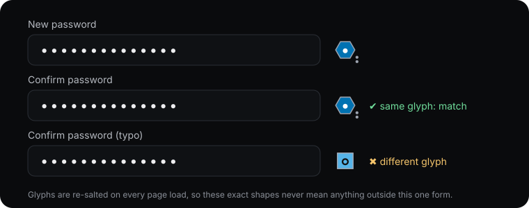

# passglyph

[](https://www.npmjs.com/package/passglyph)
[](https://github.com/MrLouisWright/passglyph/actions/workflows/ci.yml)
[](https://nodejs.org)
[](LICENSE)


> Hieroglyphs instead of password dots. The same password shows the same glyphs in both fields, so you can see a typo where it happens, without the password ever being shown.

**[Live demo →](https://mrlouiswright.github.io/passglyph/)** · [Docs (wiki)](https://github.com/MrLouisWright/passglyph/wiki) · [Security design](SECURITY-DESIGN.md) · [Launch post](docs/launch-post.md)

<p align="center"></p>

`passglyph` v2 replaces the masking dots in a password field and its confirm field with **Egyptian hieroglyphs** (a curated 64-sign set from U+13000–U+1342F). Matching passwords show the same sequence. A typo changes the glyphs **from the first wrong character on**. The glyphs are different on every page load.

It's designed so that it doesn't leak:

- **No per-character mapping.** A character → glyph table would be a substitution cipher (`balloon` would show its repeated letters). Instead, glyph *i* is `HMAC-SHA-256(key, password[0..i])` truncated to **4–6 bits** (default 5, 32 glyphs). Repeated characters get unrelated glyphs.
- **Per-instance 128-bit random key**, imported as a **non-extractable** WebCrypto key; the salt bytes are wiped. Without the key a screenshot or recording tells you nothing, and sessions or sites can't be correlated.
- **The real `<input type="password">` stays exactly that.** The glyphs are drawn on an `aria-hidden` canvas overlay aligned with the caret. It scrolls with the text and handles selection, paste, IME, RTL, font size and resizing. Autofill, password managers and screen readers work as usual.
- **No code points in the DOM.** Glyphs come from a bundled bitmap sprite drawn with `Path2D`, so there's no font and no `𓂀` text. A DOM snapshot is identical for any two passwords.
- **No extra length or timing leak.** One glyph per dot, one repaint per input, no per-keystroke flourish, and work that depends only on the length.
- **Falls back to normal dots** if canvas, Path2D or WebCrypto is missing.
- **Accessible:** a polite live region announces "Passwords match" or "Passwords don't match".
- **CSP-safe:** no `<style>` injection, no eval, no network, no storage.

**The honest part:** each position shows about 5 bits *under that session's key*. If an attacker had the key, they could recover the password one character at a time. The key never leaves memory, and anything that could read it could read the input anyway. Inline mode also reveals *where* the first typo is (that's the point). The numbers are below and in [SECURITY-DESIGN.md](SECURITY-DESIGN.md). Want the stricter v1 behaviour (one PBKDF2 glyph beside each field, ≤ 12 bits total)? Use `mode: 'badge'`.

**Sizes (min+gzip):** core 3.2 KB · hieroglyph sprite 3.8 KB (separate file, `passglyph/hieroglyphs`) · badge alphabet 1.3 KB (separate file, `passglyph/glyph`) · IIFE bundle with everything 8.2 KB. Zero dependencies, TypeScript types, ESM + CJS + IIFE. Vanilla JS, a `<pass-glyph>` web component, and React and Vue wrappers.

## Install

```bash
npm i passglyph
```

CDN: `<script src="https://unpkg.com/passglyph"></script>` → `window.passglyph.attach(...)`.

## Usage

### Vanilla

```js
import { attach } from 'passglyph';

const detach = attach(
  document.querySelector('#password'),
  document.querySelector('#confirm'),
  { onChange: (match) => submit.disabled = match === false },   // mode: 'inline' by default
);
// later: detach();
```

### Web component

```html
<script type="module">import 'passglyph/element';</script>

<pass-glyph mode="inline" bits="5">
  <input type="password" autocomplete="new-password">
  <input type="password" autocomplete="new-password">
</pass-glyph>

<!-- or point it at existing inputs -->
<pass-glyph for="password" confirm="confirm"></pass-glyph>
```

It fires `passglyph-change` with `event.detail.match` (`true` / `false` / `null`).

### React

```jsx
import { useRef } from 'react';
import { usePassGlyph } from 'passglyph/react';

function SignUp() {
  const pw = useRef(null), confirm = useRef(null);
  usePassGlyph(pw, confirm, { mode: 'inline' });
  return <><input ref={pw} type="password" /><input ref={confirm} type="password" /></>;
}
```

### Vue 3

```vue
<script setup>
import { ref } from 'vue';
import { usePassGlyph, vPassGlyph } from 'passglyph/vue';
const pw = ref(), confirm = ref();
usePassGlyph(pw, confirm);
</script>
<template>
  <input ref="pw" type="password" /><input ref="confirm" type="password" />
  <!-- or: <div v-pass-glyph="{ mode: 'badge' }"><input type="password"><input type="password"></div> -->
</template>
```

`react` and `vue` are optional peer dependencies. The wrappers are separate subpaths, so the core never imports them.

## API

### `attach(password, confirm, options?) → detach()`

| Option | Default | Description |
|---|---|---|
| `mode` | `'inline'` | `'inline'`: hieroglyphs replace the dots. `'badge'`: one v1 glyph beside each field |
| `bits` | inline `5`, badge `10` | Inline: bits **per position**, 4–6 (16/32/64 glyphs). Badge: total bits, 4–12. Clamped |
| `minLength` | `8` | Length before anything is announced (badge: before a glyph is shown). Minimum 4 |
| `debounce` | `300` | ms of quiet before the announcement (badge: before the repaint). Minimum 100 |
| `size` | inline `1.1`, badge `20` | Inline: glyph cell width in em. Badge: glyph size in px |
| `iterations` | `60000` | Badge only: PBKDF2 iterations (minimum 10,000) |
| `budget` | `250` | Badge only: fixed repaint deadline after the debounce |
| `unstyled` | `false` | Don't style the badge canvases or hide the live region (style `.passglyph-sr` yourself). The inline overlay is always positioned |
| `labels` | `{ match: 'Passwords match', mismatch: "Passwords don't match" }` | Live-region text |
| `onChange` | — | `(match: boolean \| null) => void` |
| `onFallback` | — | `(reason: 'canvas' \| 'webcrypto') => void` when passglyph falls back to native dots |
| `mount`, `mountStatus` | — | Custom placement of badge canvases / the live region |
| `crypto` | `globalThis.crypto` | WebCrypto implementation |
| `unsafeSalt` | — | **Testing only:** fixed salt for reproducible sequences. Never use it in production |

DOM added in inline mode: one `<canvas class="passglyph-overlay" aria-hidden="true">` per input, a few CSSOM properties on the input (`color`, `-webkit-text-fill-color` transparent, `caret-color`, `letter-spacing`), and one `<span class="passglyph-sr" role="status" aria-live="polite">`. `detach()` restores the inputs exactly and removes everything.

### Lower level

| Export | Description |
|---|---|
| `createSalt(crypto?)` | `"passglyph/v1"` ‖ 16 random bytes; throws without a CSPRNG |
| `instanceKey(salt, crypto?)` | Non-extractable HMAC-SHA-256 key; wipes `salt` |
| `glyphSequence(key, value, bits?, crypto?)` | One index `< 2^bits` per code point, each from the HMAC of the prefix |
| `hieroglyphPath(i)`, `HIEROGLYPH_COUNT` | Sprite path data (32×32 units) for **drawing only** |
| `deriveIndex`, `glyphOps`, `neutralOps`, `paint`, `opsToSVG`, `clampBits` … | Badge mode building blocks (v1) |

## The trade-off, in numbers

Inline mode, per position (b = `bits`):

| b | glyphs | typo missed at its position | missed at it and the next 9 | with the key (never exposed): survivors per position |
|---|---|---|---|---|
| 4 | 16 | 6.25 % | ≈ 10^-12 | ≈ 6 of 95 |
| **5** | **32** | **3.1 %** | **≈ 10^-15** | **≈ 3 of 95** |
| 6 | 64 | 1.6 % | ≈ 10^-18 | ≈ 1.5 of 95 |

**Without the key** (screenshots, shoulder surfing, recordings, DOM snapshots) the sequence reveals nothing beyond the length the dots already showed, plus the position of the first mismatch. **With the key** it reveals about b bits per character, so treat it as near-full disclosure. That's why the key is non-extractable, per instance and memory-only. Badge mode reveals ≤ 12 bits in total, even with the salt.

## Compared

| | passglyph | Chroma-Hash | hashmask |
|---|---|---|---|
| Shows the hint inside the field | ✔ inline hieroglyphs (or badge) | ✖ bars beside | ✖ beside |
| Typo position visible | ✔ (inline) | ✖ | ✖ |
| Last activity | 2026 | 2018 (jQuery plugin, 2009 idea) | 2013 (Chrome extension; Arc90 demo 2009) |
| Per-session random salt | ✔ 128-bit | ✖ static developer-set salt (same colours every visit) | ✖ stable by design (to aid memorability) |
| Keyed derivation | ✔ HMAC, non-extractable key (inline); PBKDF2 60k (badge) | ✖ single MD5 | ✖ fast hash |
| Entropy shown | 4–6 bits per position (inline); 4–12 total (badge) | 1–4 colour bars, 12 bits each (4-bit components) | not capped |
| Nothing derived in DOM | ✔ canvas only | ✖ CSS colours | ✖ |
| Accessible match announcement | ✔ | ✖ | ✖ |
| Not colour-only | ✔ shape + mark | ✖ | partial |
| Short-input & timing protection | ✔ | ✖ | ✖ |
| CSP-safe, zero deps | ✔ | jQuery | ✖ |
| Web component / React / Vue | ✔ | ✖ | ✖ |

## Limitations and trade-offs

- **Not a strength meter**, and **not protection against keyloggers, malicious extensions, XSS or compromised scripts**: they can read the input directly.
- **Inline mode reveals where the first typo is**, and is only as strong as the in-memory key (see above). Use `mode: 'badge'` for the v1 guarantees.
- **Caret alignment** relies on matching the browser's mask-character width with `letter-spacing`. That's tuned for Chromium/WebKit (`•`) and Firefox (`●`). Exotic fonts may be off by a fraction of a pixel per character.
- **IME composition** shows native dots until it's committed.
- A typo in the very last character is caught only by that one glyph (1 − 2^-b), and the "Passwords don't match" announcement covers it.
- Hieroglyphs are 1-bit 32×32 sprites derived from Noto Sans Egyptian Hieroglyphs (OFL-1.1, see [NOTICE](NOTICE)). Wide signs render small.
- It's a hint, not verification. Still compare on submit.

## Browser support

Every browser with WebCrypto `subtle`, canvas, `Path2D` and `measureText`: all current evergreen browsers. Without them you get plain dots. WebCrypto requires a secure context (HTTPS or localhost). On Node 18, pass `crypto: require('node:crypto').webcrypto` (only relevant for tests).

## Upgrading from v1

`attach()` now defaults to `mode: 'inline'`. Pass `mode: 'badge'` (or `<pass-glyph mode="badge">`) to keep v1 behaviour. `bits` means bits per position in inline mode. A missing WebCrypto now falls back to dots instead of throwing.

## Releasing

Publish a GitHub release for tag `vX.Y.Z`: `release.yml` tests, then publishes to GitHub Packages as `@mrlouiswright/passglyph`, and to npm with provenance once the `NPM_PUBLISH` repository variable is `true`.

## Support

If this project is useful to you, you can support its development with a donation: [Buy me a coffee](https://donate.stripe.com/aFa00lek3cvX4Ds2Fk9EI0b). It helps keep these tools maintained, documented and free for everyone.

## Credit (optional)

Free to use under MIT, no attribution required. If passglyph helps you, a link back is appreciated:

```html
<a href="https://louiswright.co.uk">Built with passglyph by Louis Wright</a>
```

```markdown
[](https://louiswright.co.uk)
```

## License

MIT © Louis Wright ([Louis Wright](https://github.com/MrLouisWright))
